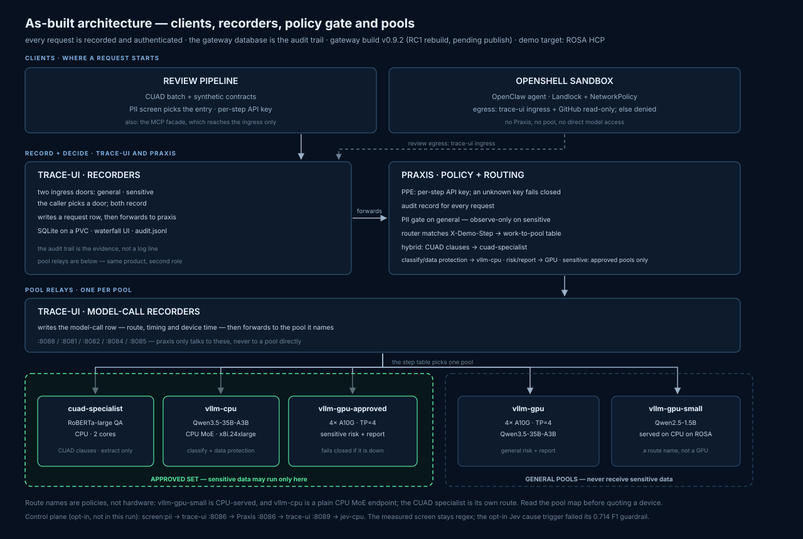
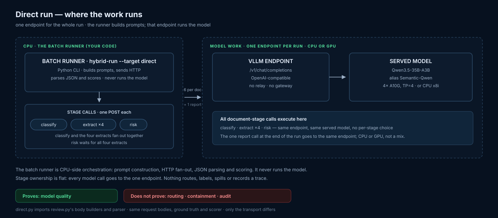
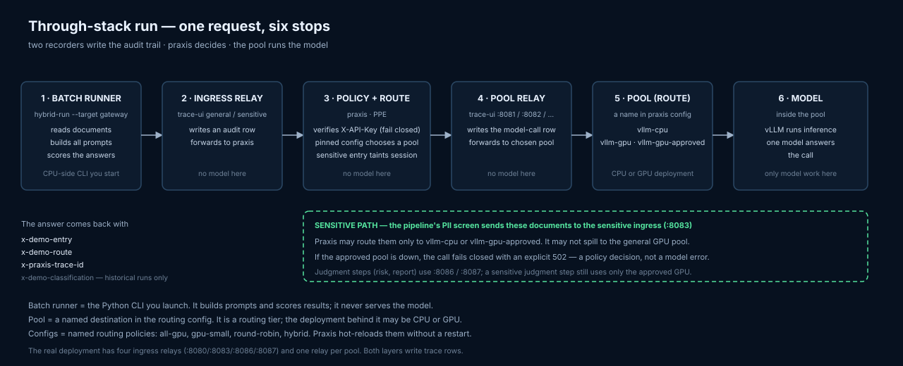

# Contract portfolio intelligence on private, hybrid CPU + GPU inference

A legal-ops demo, fully measured: a corpus of contracts is screened for
personal data, clause extraction runs on a fine-tuned specialist (CPU,
milliseconds per clause, **cannot hallucinate — it returns spans of the
source document**), risk judgment and cross-document synthesis escalate to a
Qwen3.5-35B-A3B MoE, and **every request is routed and audited by
[Praxis](https://github.com/praxis-proxy/ai)** — no classifier in the
request path (removed 2026-11-05; FINDINGS §15.5). Documents containing
personal data are pinned to approved in-cluster pools only and **fail closed**
rather than spill. Batch volume runs on CPU; GPU is for governed work,
interactive drill-down and burst. Quality is scored against expert ground
truth ([CUAD](https://www.atticusprojectai.org/cuad)), routes and device-time
are recorded per request, and the gateway's own database is the audit trail.

The product direction is **portfolio intelligence**: retrieval-first,
evidence-first — docling ingestion on CPU, legal embedders tiered by
measured regime (within-doc 0.6B on CPU, cross-doc portfolio queries on the
8B — FINDINGS §11), specialist span extraction, MoE synthesis over the
retrieved evidence, governance at every hop. See [FINDINGS.md](FINDINGS.md)
§11 for the design and §3/§10 for the measured results that justify it.

Built on [RMalone8/llm-d-sc-demo](https://github.com/RMalone8/llm-d-sc-demo)
(Praxis gateway + trace UI), extended with the specialist pool, the CUAD
pipeline, the measurement harness and the OpenShell sandbox.

> **New to the repo?** Read [docs/design.md](docs/design.md) first: the system
> map and naming model (routing-policy names, route names, models, and actual
> hardware are five different things), the routing/governance design and why
> there is no classifier, the upstream-composition policy, the semantic-routing
> path, and the open decisions. Then use this README as the runbook and
> [FINDINGS.md](FINDINGS.md) as the measurement record.
>
> **Read [What is measured vs simulated](#what-is-measured-vs-simulated)
> before quoting any number.**

**Slides:** [View the published 19-slide demo deck](https://maryamtahhan.github.io/governed-contract-intelligence/) · [docs index](docs/README.md)

## Contents

- [Status: built vs designed](#status-built-vs-designed)
- [How it fits together](#how-it-fits-together)
- [What runs where](#what-runs-where)
- [Repository layout](#repository-layout)
- [The naming model in one minute](#the-naming-model-in-one-minute)
- [Linux runbook](#linux-runbook)
- [OpenShift runbook](#openshift-runbook)
- [Dashboard and replay](#dashboard-and-replay)
- [Tests and checks](#tests-and-checks)
- [Experiments and measurements](#experiments-and-measurements)
- [Optional open-source integrations](#optional-open-source-integrations)
- [Measurement design](#measurement-design)
- [Headline results](#headline-results)
- [What is measured vs simulated](#what-is-measured-vs-simulated)
- [Manage the sandbox](#manage-the-sandbox)
- [Tear down](#tear-down)
- [Known gaps](#known-gaps)

## Status: built vs designed

| capability | state |
|---|---|
| Praxis routing, governance, fail-closed, audit export | **built, verified on 3 stacks** |
| PPE policy layer: per-step API keys, key-to-step binding, audit records, PII gate | **built and live-validated on RC1** — 27/27 fake-pool policy smoke and 28/28 real-pool resilience smoke; 200-document RC1 matrix recorded (design §3.1, FINDINGS §18) |
| CUAD review pipeline (extraction → risk → report), scored vs ground truth | **built** |
| CUAD specialist pool (RoBERTa-large QA, model endpoint only) | **built** |
| Semantic cache in the specialist (V5 ordering rules, zero-FP threshold) | **built, measured** |
| Four-arm measurement (A/B/C/D) + model-variant comparison on OCP | **built** |
| Trace UI (waterfall, arms panel, dashboard, audit) | **built** |
| Test suite | **248 tests green** (`cd demo && uv run pytest`) |
| Contract-step taxonomy + evaluation harness | **candidate, not measured** — evaluate before routing ([design §5](docs/design.md)) |
| Gateway image `v0.9.2` (Praxis 0.7.5 / ai-gateway 0.9.0 + PPE host plugins) | **published RC1 image and current measured image** — digest `sha256:3140a8dad2626ef71504546fa7901f53d9ec68ac49ed20e39919ae0af71c77c6`; carried the 2026-11-12 real-pool 200-document matrix, the 27/27 fake-pool policy smoke and the 28/28 real-pool resilience smoke. The previous 2026-11-11 record ran `v0.9.1` ([docs](deploy/images/praxis-llm-d-sc/README.md)) |
| Retrieval evaluation (chunking + recall@k/MRR vs annotation spans) | **run, both regimes — ordering inverts within-doc, restores cross-doc (FINDINGS §11)** |
| OSS adapters (Presidio, Jev/Laya, nervaluate, ranx, docling, RedisVL, OTel, RAGAS, llm-d sim/batch/bench) | **built as opt-in swaps, default path unchanged** ([design §4](docs/design.md)) |
| docling ingestion + PII screen at ingest | adapter built; default remains builtin/regex, not yet measured on the corpus (FINDINGS §16) |
| hybrid-bench concurrency sweep, thinking-mode A/B, V2 tool-calling | wrapper built; sweep open (FINDINGS §9) |

## How it fits together

The product pipeline — what a batch of contracts flows through:

```
docling ingestion (CPU)  ─>  PII screen at ingest                 [designed]
        │   structure-aware chunks, char offsets preserved
        v
litil-embed-0.6b retrieval (CPU tier)                             [measured, §11]
        v
CUAD specialist span extraction (CPU, ms/clause)                  [built]
        │   span JSON + evidence chunks
        v
Qwen3.5-35B-A3B synthesis: risk judgment, cross-doc report        [built]
```

Every hop goes through the same governed request path — the part that is
built, governed and measured end-to-end today:



The two run shapes are deliberately different, and the diagrams make the
difference explicit:

- **Direct run** — one endpoint for the whole run, no relay, gateway, label,
  pool choice or trace. It measures model quality only.

  

- **Through-stack run** — batch runner → ingress relay → Praxis (PPE policy
  gate + pinned routing) → pool relay → pool → model. It measures routing,
  governance, audit and cost.

  

  The six stops are three kinds of work: the CLI builds and scores, the two
  trace-ui relays record, and Praxis decides. Only the last stop runs a model.

Key properties of the governed path:

- **Sensitivity is the only routing choice the app makes.** The PII screen
  sends personal-data documents to the sensitive entry; everything else goes
  to general. The app never names a pool or a port.
- **Praxis owns the work-to-pool table.** Inside each entry, the router
  matches `X-Demo-Step`: CUAD clause extraction to `cuad-specialist`,
  classify and data-protection extraction to `vllm-cpu`, risk/report to a
  GPU route. The general entry uses `vllm-gpu`; the sensitive entry uses
  `vllm-gpu-approved` and its failover set contains *only* that approved
  backend, so it **fails closed** rather than spill. General CPU work
  degrades to the general GPU with a visible "fell back" badge.
- **Judgment is worth a GPU.** Risk and report route to the GPU with no CPU
  fallback; sensitive judgment pins to the approved GPU only. Extraction,
  including the termination follow-up, stays on CPU.
- **The specialist is a model, not a router.** It answers the CUAD clauses
  extractively and returns 400 for anything else; a misroute stays visible
  instead of being silently forwarded inside the pod.
- **Praxis reaches the pools only through the trace-ui relays** — every
  request recorded with route, per-hop timings; SQLite is the audit trail,
  exported as `audit.jsonl`.
- **Every request is authenticated and scope-bound at the gateway.** Each
  pipeline step presents a per-step `X-API-Key`; unknown or missing keys fail
  closed, and the key's `step:<stage>` grant must match `X-Demo-Step`. The
  general entry runs the PII scanner as a gate; the screen and sensitive
  entries keep it observe-only for the comparison. The same policy layer
  emits request records.
- **The same praxis configs** (`manifests/base/praxis/`) drive the Linux
  stack and OpenShift, so routing is byte-identical on both.
- **Configs** (measurement baselines, swapped live): **A** `one-pool` (old
  `all-gpu`, large model), **B** `small-first` (old `gpu-small`, small model),
  **C** naive hybrid round-robin, **D** the hybrid policy — two data-classification entries with the `X-Demo-Step` route
  table inside them, and fail-closed sensitive failover.
  The measured D run predates the rebuilt route table (and the specialist
  split); re-measuring it is a new run directory, not a reinterpretation of
  the old one (FINDINGS §15.5, §15.9).

## What runs where

| Environment | What runs | How |
|---|---|---|
| **Linux host (podman/docker)** | Real Praxis + trace-ui, simulated vLLM backends | `scripts/linux/up.sh` |
| **g5.12xlarge (stopped, AMI kept)** | Real vLLM: 1.5B CPU, 7B/1.5B GPU — the measured GPU-vs-CPU story | warm-restart the AMI; `scripts/linux/up.sh --real` |
| **OpenShift (rhgaudi3s2 SNO)** — validation | Real vLLM pools, all CPU-served (1.5B / 7B / 9B / 35B-A3B MoE / specialist), full platform validation | `deploy/openshift/*` overlays; `deploy/openshift/cpu-isolation/` |
| **ROSA HCP — demo target (measured 2026-11-12, RC1, torn down the same day)** | x8i.24xlarge CPU (48 cores, AMX) + g5.12xlarge (4× A10G, TP=4) in one AZ, explicit taskset pinning, per-node gp3 caches | `deploy/openshift/rosa/` — rebuild from its README |
| **Dev machine (tests)** | Fake pools + trace-ui + a praxis stub that parses the real configs | `cd demo && uv run pytest` |

The simulated backends speak the OpenAI subset, report device-time, simulate
prefix caching and inject deterministic tiered errors, so routing,
governance, failover and measurement run on a CPU-only instance and in CI.
**Quality and dollar numbers from them are simulation** — point the stack at
real vLLM pools (Linux compose profile `real`, the g5, or OpenShift) for
measured numbers.

## Repository layout

Everything measurable lives in `demo/`; everything deployable lives in
`manifests/`, `deploy/`, `scripts/` and `sandbox/`; the current recorded
evidence lives in `runs/`. Historical run directories referenced in
[FINDINGS.md](FINDINGS.md) and in the results below are archived at commit
`ea80dfb` — [`runs/README.md`](runs/README.md) lists them and shows how to
restore one.

```
.
├── README.md                     this runbook
├── FINDINGS.md                   the measurement record — read before quoting numbers
├── demo/                         Python package, tests and experiment tools
│   ├── src/
│   │   ├── hybrid_demo/
│   │   │   ├── pipeline/       generator, review pipeline, direct runner, batch, CUAD converter, risk, schemas
│   │   │   ├── specialist/     CUAD RoBERTa QA server, questions, semantic cache
│   │   │   ├── retrieval/      chunking, docling adapter, index, retrieval eval + e2e
│   │   │   ├── evalkit/        scorer, span/stats/rag checks, cost, live sampler, contract-step + PII-agreement evals
│   │   │   ├── fakepool/       simulated backends + llm-d-inference-sim adapter
│   │   │   ├── traceui/        recording relays, dashboard backend, audit, OTel export
│   │   │   ├── ui/             stage dashboard (replay + live modes)
│   │   │   ├── mcp/            MCP facade: review + stage tools, ingress only
│   │   │   ├── jev/            System One endpoint for the opt-in jev-cpu pool
│   │   │   ├── pii.py          pluggable PII detectors (regex default)
│   │   │   ├── configs.json    single source of routing-config metadata
│   │   │   └── common.py, routes.py, bench.py, classifier.py
│   │   └── docker/             Dockerfile, Dockerfile.jev, Dockerfile.specialist
│   ├── tests/                    248-test suite, incl. e2e against a praxis stub
│   └── tools/                    probes, validators, paired significance, PII compare, bench helpers
├── manifests/
│   ├── base/                     non-KServe platform: praxis, trace-ui, traffic-gen, netpols
│   │   └── praxis/               the four routing configs + PPE policies + API-key digests
│   └── overlays/                 opt-in overlays (e.g. trace-ui route)
├── deploy/
│   ├── linux/                    docker-compose / podman-compose stack (fake and real profiles)
│   ├── openshift/                cpu-real* model-pool overlays, fake-all/fake-gpu, gpu-moe,
│   │                             rosa, cpu-isolation
│   └── images/praxis-llm-d-sc/   reproducible gateway image build (filter + PPE host)
├── scripts/
│   ├── linux/                    up, down, smoke, arms, set_config, demo choreography
│   ├── cluster/                  OpenShift arms, direct, smoke, model-comparison, cpu-topology
│   ├── demo/                     pull-the-plug, blocked-action
│   └── data/                     CUAD fetch
├── runs/                         current evidence (quoted record, guide appendix); archive map: runs/README.md
├── docs/
│   ├── README.md                     docs index
│   ├── design.md                     the design document (system map, decisions, open items)
│   ├── architecture-as-built.svg     through-stack architecture
│   ├── pipeline-direct.svg           direct-run shape
│   ├── pipeline-through-stack.svg    one request, six stops
│   ├── stage-runbook.md              one-page stage script
│   ├── stage-review-walkthrough.html presenter guide
│   ├── demo-deck.html                19-slide deck (published via GitHub Pages; arrow keys, N notes, P print)
│   └── octo-demo-v0.3.md             business case / OCTO framing
├── mcp/                          root launcher for the MCP facade
├── classifiers/                  contract-step taxonomy + evaluation anchors (candidate)
├── sandbox/policy.yaml           OpenShell sandbox egress policy (trace-ui ingress + GitHub read-only)
├── values/                       OpenShift Helm overrides
└── .github/workflows/            CI + gateway image publish + Pages
```

Where to look for what:

| I want to… | Read / run |
|---|---|
| browse all documentation | [`docs/README.md`](docs/README.md) |
| understand why the system is built this way | [`docs/design.md`](docs/design.md) |
| run the demo locally | [Linux runbook](#linux-runbook) |
| run it on OpenShift / rebuild ROSA | [OpenShift runbook](#openshift-runbook), [`deploy/openshift/rosa/README.md`](deploy/openshift/rosa/README.md) |
| see what was measured, and how | [`FINDINGS.md`](FINDINGS.md), [`runs/README.md`](runs/README.md) |
| run or extend the test suite | [Tests and checks](#tests-and-checks) |
| reproduce a measurement | [Experiments and measurements](#experiments-and-measurements), [design §4.4](docs/design.md) |
| give the stage demo | [`docs/stage-runbook.md`](docs/stage-runbook.md), [`docs/stage-review-walkthrough.html`](docs/stage-review-walkthrough.html) |
| present the demo and findings | [published deck](https://maryamtahhan.github.io/governed-contract-intelligence/) or [`docs/demo-deck.html`](docs/demo-deck.html) (open in a browser; `P` prints 19 pages) |
| understand a run directory or config name | [`runs/README.md`](runs/README.md), [design §2](docs/design.md) |

## The naming model in one minute

A run directory, a config name, a route name, a model name and actual
hardware are **five different things** (full treatment: [design §2](docs/design.md)):

| Layer | Example | Where to read it |
|---|---|---|
| Run directory | `runs/rosa-200-2026-11-12-praxis-routes/hybrid` | the path; maps to one recorded run |
| Routing policy / config | `hybrid` (old D) | `summary.config`; legacy `summary.arm` |
| Route / cluster | `vllm-cpu`, `vllm-gpu-approved` | `x-demo-route` response header; `summary.routes` |
| Served model | `Qwen3.5-35B-A3B`, `cuad-specialist` | response `model`; `summary.stage_models` |
| Actual hardware | `4× A10G`, `CPU x8i.24xlarge` | `summary.pools[route].hardware` |

Two rules follow from this:

1. **Never infer hardware from a route or config name.** On ROSA,
   `vllm-gpu-small` is served by Qwen2.5-1.5B **on CPU**; `one-pool` (old
   `all-gpu`) is a routing policy, not a hardware promise.
2. **Routes name one endpoint since the 2026-11-10 rebuild.**
   `cuad-specialist` is the RoBERTa service and `vllm-cpu` is the CPU MoE;
   there is no forwarding inside the specialist. The pre-rebuild 2026-11-09
   runs predate the split, when `vllm-cpu` was composite; they were pruned
   from the working tree and are recoverable at commit `d551c7b` — read
   `summary.stage_models` for those runs rather than assuming the new graph.

## Linux runbook

Prerequisites: podman or docker with a compose provider, `uv`, `curl`. On a
podman host without compose:

```bash
python3 -m venv ~/pv && ~/pv/bin/pip install podman-compose
curl -LsSf https://astral.sh/uv/install.sh | sh
```

Start the simulated stack (no GPU, no model downloads):

```bash
export COMPOSE="$HOME/pv/bin/podman-compose"    # or "docker compose"
export PATH="$HOME/.local/bin:$PATH"

scripts/linux/up.sh        # build + start the stack (hybrid config), wait for readiness
scripts/linux/smoke.sh     # 27 checks: routing, fallback, fail-closed, governance, audit,
                           # key-to-step binding, the general-entry PII gate, and scanner lines
DOCS=40 scripts/linux/arms.sh   # all four routing configs on the same documents + report
scripts/linux/demo.sh      # choreographed on-stage run (pauses between acts)
scripts/linux/down.sh      # stop (-v also deletes the trace database)
```

Outputs: `runs/report.md` (+ `.json`, `.html`), per-config directories such as
`runs/hybrid/`, and the live dashboard on <http://127.0.0.1:8080>. Pull the
plug yourself: `podman stop hybrid-demo_fake-gpu_1`.

Real models instead of simulated ones (needs an NVIDIA GPU, the container
toolkit, and ~40 GB for weights):

```bash
scripts/linux/up.sh --real
```

Real contracts instead of synthetic: `scripts/data/fetch-cuad.sh`, convert
with `hybrid_demo.pipeline.cuad` (CUAD v1, CC BY 4.0 — verify before use;
use `--split test` for specialist comparisons, contamination discipline).
CUAD runs need the real-model stack. Then:

```bash
DOCS=40 DATA=data/cuad-test scripts/linux/arms.sh
```

## OpenShift runbook

Prerequisites: OpenShift ≥ 4.19 (Landlock) with cluster-admin, `oc`, `helm`,
the `openshell` CLI, and RHOAI/KServe only if you use the KServe base. The
ROSA overlay uses plain Deployments and needs no KServe.

Two deployment shapes:

- **KServe base** (`manifests/` + the InferenceService objects):
  ```bash
  oc login ...
  ./scripts/00-prereqs.sh            # checks + Agent Sandbox CRD/controller
  ./scripts/01-install-openshell.sh  # OpenShell gateway (Helm)
  ./scripts/02-apply.sh              # praxis, trace-ui, netpols, KServe pools
  ./scripts/03-create-sandbox.sh     # OpenClaw sandbox, egress: trace-ui ingress + GitHub read-only
  ```
- **ROSA / plain-Deployment stack** (`manifests/base` + `deploy/openshift/rosa`):
  follow [`deploy/openshift/rosa/README.md`](deploy/openshift/rosa/README.md).
  It covers machine pools (both in one AZ), the GPU operator, `taskset` core
  lists from the real node, cache seeders, the specialist build and the
  bring-up order. The overlay is deliberately non-KServe.

Model pools are plain Deployments applied by CPU-model overlays — swap
variants with
`scripts/cluster/model-comparison.sh {base|moe|moe-thinking|9b|specialist|specialist-moe}`
(each applies `deploy/openshift/cpu-real-*`, warms praxis, runs config hybrid
on a CUAD document set — set `DATA=data/cuad-test` for the held-out split —
into `runs/cuad-mixed/hybrid-<variant>` with metrics sampling; that is the
historical default output path, so set `RUNS=` for a new series). The
overlays carry the platform fixes from FINDINGS §7 (cpu
limits, writable cache volumes, /dev/shm sizing, model-cache PVC for small
models, emptyDir for the MoE — read it before changing anything).

**CPU pinning is environment-specific.** The SNO validation pools assume the
NTO CPU-isolation profile in [`deploy/openshift/cpu-isolation/`](deploy/openshift/cpu-isolation/):
SMT siblings offlined so one CPU request is one physical core, and
`single-numa-node` placement. That profile is **generated for the node it
runs on**, not portable (the SNO is a Xeon 6960P with six 24-core NUMA
nodes). ROSA managed nodes cannot use it: the ROSA overlay pins each pool
with `taskset` instead and documents why in
[`deploy/openshift/rosa/kustomization.yaml`](deploy/openshift/rosa/kustomization.yaml).
On any new node, read `lscpu` first and regenerate the core lists.

The gateway image is published by this repo because upstream `ai` has neither
the optional routing filter nor the PPE policy host; the `publish-images`
workflow builds it from
[deploy/images/praxis-llm-d-sc/](deploy/images/praxis-llm-d-sc/README.md).

The current measured image is `v0.9.2` (Praxis 0.7.5 / ai-gateway 0.9.0,
PPE 0.4.1 host plugins; digest
`sha256:3140a8dad2626ef71504546fa7901f53d9ec68ac49ed20e39919ae0af71c77c6`).
It carried the 2026-11-12 real-pool 200-document matrix and the 28/28
`STACK=rosa` resilience smoke. The previous 2026-11-11 stack ran `v0.9.1`
(digest
`sha256:d17410449aec2f30a8d07819503ad00badaab398a4f18a1d4692961026c91c56`).
The policy layer runs on every entry: per-step API keys bound to
`X-Demo-Step`, request records, and the PII scanner — enforcing on the general
entry, observe-only on the screen and sensitive entries. `v0.9.1` predates
RC1: it carries the audit observer and observe-only scanner, not
`validator/gci-step-key` or `validator/gci-pii-gate`. The RC1 policies also
passed a 27/27 live smoke on ROSA using the fake-all overlay; that is
functional policy evidence, not a new model-quality measurement. The policy
declarations grant `read_roles` to the step-key and audit plugins because
`read_subject` alone exposes only the subject id. The optional
complexity-routing filter remains in the image for the contract-step
experiment but is not in the request path.

The first revision tried model-labelled complexity routing. Every
contract-analysis step came back MEDIUM and went to the same pool, so the
classifier was removed; routing now uses the declarative step-to-pool table
(FINDINGS §15.5). The old
deployment and classifier-routed config remain in git history (`98dc861`).

Then:

```bash
scripts/cluster/arms.sh            # measurement arms through the real pools
oc -n openshell-demo port-forward svc/trace-ui 8080:8080   # dashboard
scripts/demo/pull-the-plug.sh [--restore]   # scale a GPU pool to zero mid-run
scripts/demo/blocked-action.sh     # sandbox egress denials (after 03 + port-forward)
```

Routing configs are swapped by **policy name** (`hybrid`, `one-pool`, …) —
the one catalog of names, aliases and manifests is
`demo/src/hybrid_demo/configs.json`, with `scripts/configs.sh` as its shell
adapter. `scripts/cluster/arms.sh` is the measured path: `CONFIGS="one-pool
hybrid"` selects, the default runs the full matrix, and `hybrid-run --config
hybrid` is the CLI form. Old names (`all-gpu`, `gpu-small`, `gpu-split`) and
letters remain aliases. A manual swap points the deployment at the manifest
behind the name — the files keep their historical `arm-*` filenames for
recorded-evidence compatibility, so `one-pool` is
`oc -n openshell-demo set env deploy/praxis PRAXIS_CONFIG=/etc/praxis/arm-a.yaml`
— then `oc -n openshell-demo rollout status deploy/praxis`. NetworkPolicies
restrict the pools to the trace-ui relays (the V15 enforcement layer). The
OpenClaw sandbox may reach only trace-ui's general/sensitive ingress ports
(read-write) and read-only api.github.com; Praxis and the pools are not in its
egress allowlist, so the agent cannot bypass the ingress trace row. Everything
else is denied and logged (`openshell logs`).

The trace UI has no Route in the base install — the dashboard holds contract
questions and responses. To publish it, set a token and opt in:

```bash
oc -n openshell-demo set env deploy/trace-ui TRACE_API_TOKEN=<token>
oc apply -k manifests/overlays/trace-ui-route
```

The relays reach trace-ui through the Service either way. The sandbox reaches
the internal Service, not this Route; because the ingress port also serves the
trace UI dashboard APIs, put a path-filtering proxy or token in front before
running real data. The audit trail is SQLite on the trace-ui PVC, exported as
plaintext `audit.jsonl`; raw traces
are a rolling window of 250 (`TRACE_MAX_TRACES`), so a governance check is
only complete when the window covers the run — per-run summaries in the
`runs` table are the durable record. Treat the PVC and exports as sensitive,
and apply your own retention beyond the demo's.

## Dashboard and replay

The stage dashboard runs from the checkout with no cluster and no model:

```bash
cd demo
make dashboard-up          # replay only, 127.0.0.1:8099
open http://127.0.0.1:8099/
```

It defaults to the current 2026-11-12 RC1 run
(`runs/rosa-200-2026-11-12-praxis-routes/hybrid`) with the same-run one-pool
control as B. That control is PII-gate-blocked and is boundary evidence, not
a quality comparison. Useful variants:

```bash
make dashboard-up RUN=../runs/rosa-200-2026-11-12-praxis-routes/one-pool COMPARE=   # show the one-pool control
make dashboard-live ENDPOINT=http://127.0.0.1:8000/v1   # one-document live runs
make dashboard-live HOST=0.0.0.0 LIVE_TOKEN=sesame      # token-gated, non-loopback
make dashboard-down
```

The pages are `/` (waterfall and arm comparison), `/guide` (presenter guide)
and `/monitor` (live mode). The dashboard is a replay/presentation layer; the
measured evidence remains the run directories and the trace-ui SQLite store.

The trace UI is the other half and is **live-only**: it is the recording relay
plus its rolling SQLite window, so `oc -n openshell-demo port-forward
svc/trace-ui 8080:8080` is only for viewing (or apply the opt-in Route plus
`TRACE_API_TOKEN`); replay never needs it. OTel export is off by default —
set `TRACE_OTEL=jsonl` or `otlp` on `trace-ui`; see
[design §4.3](docs/design.md).

## Tests and checks

The test suite is dependency-light by design: it runs the real routing
configs against a praxis stub and fake pools, and needs no GPU, model
download or network.

```bash
cd demo
uv sync --locked --dev
uv run pytest -q                  # 248 passed on a clean checkout
uv run ruff check src tests tools
```

What the suite covers:

| Area | Representative tests |
|---|---|
| Routing configs, aliases, CLI compatibility | `test_configs.py`, `test_run_cli.py`, `test_shared.py` |
| End-to-end through the praxis stub: routing, fallback, fail-closed, entry choice, API-key auth | `test_e2e.py`, `test_stub_config.py`, `test_policy_identity.py`, `test_review_entry.py` |
| Fake pools, scoring, cost, spans/stats, telemetry, OTel export | `test_fakepool.py`, `test_score.py`, `test_spans_stats.py`, `test_schemas_otel.py`, `test_telemetry.py` |
| PII screen, Jev/screen adapters, Jev service and gateway/pipeline agreement | `test_pii.py`, `test_jev_bench.py`, `test_jev_server.py`, `test_pii_agreement.py` |
| CUAD conversion, document ids, direct runner, generated data | `test_cuad.py`, `test_cuad_doc_ids.py`, `test_direct.py`, `test_generate.py` |
| Cause-trigger guardrail (regex vs Jev) | `test_cause_bench.py` |
| Retrieval chunking, index and OSS adapters | `test_chunking.py`, `test_retrieval_oss.py`, `test_oss_adapters.py` |
| Dashboard payload/corpus/auth, MCP facade | `test_ui_payload.py`, `test_ui_corpus.py`, `test_ui_live_auth.py`, `test_mcp_server.py` |

Optional extras add tests and tools for the corresponding adapters:

```bash
uv sync --extra mcp          # MCP server tests
uv sync --extra pii --extra spans --extra stats --extra ranking \
        --extra ingest --extra cache --extra otel --extra rag
uv sync --extra jev          # Jev/Laya PII screen; downloads a checkpoint on first use
uv sync --extra specialist   # torch/transformers; needed by the local specialist tools
uv sync --extra retrieval    # sentence-transformers; needed by retrieval eval
```

CUAD-backed tests skip cleanly when `data/cuad` is absent. The same checks run
in CI (`.github/workflows/ci.yml`), plus a **gateway-configs** job that boots
the real image and validates every praxis config:

```bash
# What CI runs for each of config.yaml / arm-a / arm-b / arm-c.
# v0.9.2 is the published RC1 image; it registers the gate and step-key
# plugins named by the current policies.
podman run --rm -v "$PWD/manifests/base/praxis:/etc/praxis:ro" \
  quay.io/mtahhan/gci-praxis:v0.9.2 --validate -c /etc/praxis/config.yaml
```

Cheap structural checks before a doc or script change:

```bash
cd demo && uv run hybrid-run --target gateway --help   # shows --config, not --arm
cd .. && for f in scripts/configs.sh scripts/linux/set_arm.sh \
         scripts/linux/set_config.sh scripts/linux/arms.sh \
         scripts/linux/demo.sh scripts/cluster/arms.sh \
         scripts/cluster/model-comparison.sh; do bash -n "$f" || exit 1; done
xmllint --noout docs/pipeline-direct.svg docs/pipeline-through-stack.svg \
                 docs/architecture-as-built.svg
```

## Experiments and measurements

A measurement is not a log line: it is a run directory under `runs/` with
`results.json` (and usually `report.md` / `.json` / `.html`), produced by one
pinned stack and one document set. Never overwrite a run directory; give a new
policy or model variant its own directory. The comparison protocol for any
component swap is [design §4.4](docs/design.md).

| Experiment | Command | Output / what it measures |
|---|---|---|
| Four-config matrix, simulated | `scripts/linux/up.sh` then `DOCS=40 scripts/linux/arms.sh` | `runs/<config>/`, `runs/report.*`; routing, governance, cost plumbing (simulated quality) |
| Four-config matrix, real pools on Linux/g5 | `scripts/linux/up.sh --real` then `DOCS=200 scripts/linux/arms.sh` | measured quality and device time |
| Four-config matrix, OpenShift/ROSA | `DOCS=200 scripts/cluster/arms.sh` | same, through the real cluster pools; `ENVIRONMENT`, `CLUSTER`, `POOLS_JSON` record provenance |
| Direct baseline (one endpoint) | `scripts/cluster/direct.sh` | `runs/direct/<pool>`; model quality without routing |
| CPU-pool model comparison | `scripts/cluster/model-comparison.sh {base|moe|moe-thinking|9b|specialist|specialist-moe}` | `runs/cuad-mixed/hybrid-<variant>`; same documents, swapped CPU pool |
| Within-doc / cross-doc retrieval | `uv run --extra retrieval hybrid-retrieval-eval --model ... --mode within|cross` | `runs/retrieval/*.json`; recall@k, MRR, NDCG/MAP |
| Retrieval end-to-end | `uv run hybrid-retrieval-e2e --baseline-run ...` | extraction F1 with retrieval in front of the specialist |
| Contract-step taxonomy | `uv run hybrid-eval-contract-steps --check` / `--base-url ...` | `runs/contract-step/eval.json`; candidate taxonomy, not a measured routing result |
| PII detector comparison | `uv run python tools/compare_pii.py --data ... --detectors regex,presidio` | sensitive share and labelled TP/FP/TN/FN |
| Jev/Laya PII screen (offline) | `uv run hybrid-jev-bench --data data/synthetic` | weights-only precision/recall vs regex; no serving claim |
| Pre-entry screen through Praxis (served shape) | `HYBRID_PII_DETECTOR=screen HYBRID_PII_SCREEN_URL=http://127.0.0.1:8086/v1/systemone uv run hybrid-review ...` | exercises the `screen:pii` control-plane route on the fake stack; not a measured arm |
| Cause-trigger guardrail | `uv run hybrid-cause-bench --deciders regex jev` | CUAD test-split termination F1; regex 0.714, Jev 0.625, so Jev is not adopted |
| Gateway vs pipeline PII screen | `uv run hybrid-pii-agreement --run <run> --logs <praxis logs>` | V19 measurement; joins observe and gate scanner records |
| Specialist quality | `uv run python tools/validate_specialist.py --docs 12` | CUAD test-split F1 for the local checkpoint |
| Semantic-cache threshold | `uv run python tools/validate_cache.py --docs 12` | hit rate and false positives per threshold; pick zero-FP point |
| Paired significance | `uv run python tools/mcnemar.py <run_a> <run_b> --k 5` | exact McNemar (statsmodels backend when installed) |
| Serving / concurrency sweep | `uv run python tools/gpu_bench.py --url ... --data ... --levels 1,4,16` | TTFT and end-to-end latency; no gateway in the path |
| Benchmark command builder | `uv run hybrid-bench --backend vllm|guidellm ... --dry-run` | the command it would run; no result parsing |
| Batch transport | `uv run hybrid-batch --gateway <praxis ingress> ...` | `/v1/files` + `/v1/batches`; must target praxis, never a pool |

Useful specifics:

- **Four-config matrix.** `CONFIGS` (or legacy `ARMS`) selects configs;
  `DOCS`, `DATA`, `CONCURRENCY` and `RUNS` override the defaults. A full
  200-document ROSA run is the measured record in FINDINGS §15.9. The
  Linux stack runs the same configs against simulated pools unless you pass
  `--real`.
- **Direct vs stacked.** `scripts/cluster/direct.sh` bypasses Praxis on
  purpose and writes to `runs/direct/<pool>`; `scripts/cluster/arms.sh` is
  the governed composite. Score both together so the report puts them in one
  table (see `deploy/openshift/rosa/README.md`).
- **Retrieval.** Commands and file naming are documented in
  [`runs/retrieval/README.md`](runs/retrieval/README.md); findings and
  caveats in FINDINGS §11.
- **Contract-step taxonomy.** The harness is 33 cases across real prompts,
  paraphrases, same-document controls, long documents and agent-shaped
  requests. Pass criteria are listed in [design §5](docs/design.md); do not
  present it as a measured routing result until the same-document control is
  4/4.
- **Sanity checks without a stack.** `uv run python -m hybrid_demo.pii`,
  `uv run python tools/compare_pii.py --data data/synthetic --detectors regex`,
  and `uv run hybrid-bench ... --dry-run` all run locally.

## Optional open-source integrations

The measured default path is unchanged: the built-in regex screen, built-in
chunker, containment scoring, SQLite trace store and dependency-free exact
McNemar all still run with the base install. Each item below is an **opt-in
swap**, because a component swap changes a number and must be A/B tested, not
silently adopted. The full audit, licences and measurement caveats are in
[docs/design.md §4](docs/design.md).

| upstream | module / flag | default | why it is a swap |
|---|---|---|---|
| Presidio | `hybrid_demo.pii`, `HYBRID_PII_DETECTOR=presidio` | regex | NER raises the sensitive share; no CUAD PII labels to score it |
| Jev / Laya | `hybrid_demo.pii`, `HYBRID_PII_DETECTOR=jev` | regex | zero-shot, no labels; only the synthetic set is labelled, and regex is already 41/0/159/0 |
| Jev served screen | `hybrid_demo.pii`, `HYBRID_PII_DETECTOR=screen`; `jev-cpu` | regex | control-plane `screen:pii` listener; removes sensitive text from the general entry, but has no measured arm yet |
| nervaluate | `hybrid_demo.evalkit.spans` | containment | adds SemEval offset metrics; paraphrases still fail offsets |
| statsmodels | `hybrid_demo.evalkit.stats` | exact binomial | same test, standard implementation/backend label |
| ranx | `hybrid_demo.retrieval.metrics`, `--metrics-backend` | internal | NDCG/MAP implementation can differ at ties |
| docling `HybridChunker` | `hybrid_demo.retrieval.docling_chunking`, `--chunk-backend docling` | builtin | chunk boundaries move; offsets are regression-checked |
| LanceDB + BM25 | `hybrid_demo.retrieval.index`, `hybrid-index` | memory | cross-doc ranking changes with the backend |
| RedisVL + Redis | `--cache-backend redis` | in-memory | cache hits change cost/latency; policy stays ours |
| OpenTelemetry | `TRACE_OTEL=jsonl` or `otlp` | SQLite only | export is additive; no content for sensitive entries |
| RAGAS | `hybrid_demo.evalkit.rag` | lexical screen | judge-dependent numbers are not comparable across judges |
| llm-d-inference-sim | `hybrid-pool-sim` | `hybrid-pool` | simulator covers transport/latency, not tiered answer corruption or device time |
| llm-d-batch-gateway | `hybrid-batch` | Python runner | batch must target the praxis ingress, never a pool directly |
| vLLM bench / GuideLLM | `hybrid-bench` | `tools/gpu_bench.py` | load generator CLI churns; pin versions in a measured run |

**Jev is a decision layer, not a replacement for Praxis or `vllm-cpu`.** The
offline `jev` adapter answers a System One `noul` question; the served
`screen` adapter sends `screen:pii` to a separate Praxis listener (`:8086`)
and the `jev-cpu` pool, so sensitive text never travels through the general
review entry. (The screen listener is a control plane, not a third review
entry.) Both are opt-in and fail closed; the regex screen remains the measured
default (41/0/159/0 on the only labelled corpus). The cause-language trigger
has the same treatment: `HYBRID_CAUSE_DECIDER=jev` is opt-in, falls back to
regex on error, and was rejected by the CUAD guardrail (F1 0.625 vs the
recorded 0.714). See FINDINGS §16.7–§16.9.

Quick checks that need no model or GPU:

```bash
cd demo
uv run python -m hybrid_demo.pii                      # detector availability
uv run python tools/compare_pii.py --data data/synthetic --detectors regex
uv run python -m hybrid_demo.bench --backend vllm \
  --base-url http://localhost:8080 --model Semantic-Qwen --dry-run
uv run python -m hybrid_demo.fakepool.llmd_sim \
  --upstream http://localhost:8001 --pool vllm-cpu --port 8000 --print-simulator-cmd
```

## Measurement design

Same documents, same replay, same scoring for every arm; the report
compares:

- **Quality vs ground truth**: clause extraction P/R/F1 (exact spans vs
  expert annotations), risk accuracy (vs majority-class baseline), report
  accuracy, documents fully correct.
- **Classifier (historical)**: the recorded arms carry predicted labels vs
  step types (the original classifier labelled all contract-analysis steps
  MEDIUM and the cross-doc report REASONING — reported honestly, FINDINGS §4,
  §15.5). New runs have no classifier and no label column.
- **Routing and governance**: CPU-served share; sensitive steps on approved
  pools; violations. Target for the hybrid config: **zero**, verified from the
  trace UI's own records, independently of the pipeline.
- **Cost**: GPU-seconds and CPU core-seconds per document, priced as a sweep
  (cloud list vs owned at 25/50/75% utilisation) — never a single $ figure.
- **Resilience**: degraded (fell-back) answers, fail-closed errors, recovery.

## Headline results

All numbers, protocols and caveats in [FINDINGS.md](FINDINGS.md) — read it
before quoting any of these:

- **Governance**: the hybrid config = 0 sensitive violations on every stack,
  every dataset — including 0/247 sensitive steps on the 2026-11-12 RC1
  ROSA run. In the RC1 matrix the one-pool, small-first and round-robin
  controls are boundary evidence, not quality controls: the general-entry
  PII gate denied 246 sensitive steps and one sensitive step slipped
  through each control on a non-approved route (1 violation). The
  2026-11-11 `v0.9.1` controls remain the last comparable leak test:
  one-pool/small-first 247/247, round-robin 110/247 (the 2026-11-10 run
  leaked 117; the earlier classifier-in-path run leaked 122); earlier
  SNO/CUAD one-pool/small-first 25, round-robin 12–24. This is a
  containment result — routing, not PII ground truth (FINDINGS §2).
- **Quality (CUAD held-out test split, 19 unique contracts)**: 1.5B F1 0.242
  (recall 1.0, precision ~0.15 — always answers, usually wrong: the worst
  failure shape for legal work); 35B-A3B MoE F1 0.690, risk 0.632 with real
  discrimination, identical on CPU and 4× A10G (same weights). The 7B was
  never run on the test split, so the old mixed-split comparison is retired.
  The retrieval-first specialist reaches F1 0.800 — a local direct run, not
  through-stack. **The CUAD risk gap is an input gap, not a judgment gap
  (FINDINGS §17):** the MoE applies the risk rubric perfectly to the clauses
  it is given (19/19 on both direct runs); every miss traces to extraction.
  With the CUAD-trained specialist doing the extraction and the MoE judging
  (`runs/cuad-test/arm-direct-specialist-rosa`), risk rises to **0.737**
  measured (**0.789** on a same-input GPU replay), above the 0.684
  majority-class baseline; the specialist is perfect on governing law and
  audit rights, and weak on CUAD's hardest category, caps on liability
  (F1 0.308) — a clause-level routing split is the unmeasured next step.
- **Direct parity (ROSA, 200 docs, 2026-11-11)**: the same 35B-A3B weights
  score identically on a bare CPU and a bare GPU (extract F1 1.0, risk 1.0;
  report 0.746 vs 0.760), and all-CPU is 9.8× slower (2949.5 s vs 301.6 s).
  The 1.5B CPU baseline is not a judgment substitute: extract F1 stays 1.0,
  but risk falls to 0.395 and report to 0.212. The specialist's `termination`
  field used to be the one quality loss in the governed path (F1 0.982;
  173/200 fully correct): all 27 misses were synthetic termination-for-cause
  clauses scored against CUAD's **Termination For Convenience** question,
  with precision still 1.000 — a taxonomy mismatch, not the device. The
  conditional cause follow-up (canonical question first, cause question only
  on no-span + cause language) closes it: extraction F1 1.000, zero false
  positives, 200/200 fully correct, with CUAD held-out termination F1
  unchanged at 0.714. Direct runs are ungoverned by construction (all 247
  sensitive steps on one endpoint).
- **Routing and quality (ROSA, RC1, 200 synthetic docs, 2026-11-12)**:
  the hybrid config ran in **818.87 s** with 0 errors, 0 fallbacks and
  **0 sensitive violations**. Route counts are the rebuilt table:
  `vllm-cpu` 400, `cuad-specialist` 600, `vllm-gpu` 159 (non-sensitive
  risk) and `vllm-gpu-approved` 42 (41 sensitive risk + 1 portfolio
  report). Quality: extract F1 **1.000**, risk **0.995**, report **0.998**,
  **199/200 documents fully correct**. 247/247 sensitive steps stayed on
  the approved set and 201/201 judgment steps ran on GPU. The previous
  2026-11-11 `v0.9.1` hybrid row remains 806.59 s, F1/risk/report 1.000,
  200/200. See `runs/rosa-200-2026-11-12-praxis-routes/report.md` and
  FINDINGS §15.12.
- **Cost (2026-11-12 RC1)**: device time is measured for the current graph:
  hybrid **0.259 GPU-s/doc** and **33.006 CPU core-s/doc**. The previous
  2026-11-11 row was 0.265 GPU-s/doc and 32.555 CPU core-s/doc. The current
  RC1 controls are PII-gate boundary evidence, not cost comparisons; the
  last comparable control costs are the 2026-11-11 one-pool 0.981 GPU-s/doc
  and small-first 2.429 GPU-s/doc. The 2026-11-10 hybrid run's per-pool
  device time remains **`n/a`**, not zero; the older 0.22 GPU-s/doc figure
  belongs to the pre-rebuild 2026-11-09 graph (recoverable at `d551c7b`)
  and must not be quoted for the rebuilt graph.
- **Retrieval (single runs)**: regime decides the winner. Within-document
  (the retrieve-then-extract regime) the MTEB(Law) ordering inverts — the
  0.6B litil beats the top-scoring 8B by ~10 points on R@1/MRR
  (McNemar p = 0.0075); cross-document (the portfolio-query regime) the 8B
  wins back (MRR 0.940 vs 0.829). Tiers by regime, not by leaderboard
  (FINDINGS §11).
- **Method > backbone** [external]: the CUAD leaderboard's method ladder
  (Standard 72.9 → RAG 79.3 → multi-agent 85.8) — the argument for the
  retrieval-first pivot.

## What is measured vs simulated

| Component | Linux stack | OpenShift (ROSA / g5) |
|---|---|---|
| Praxis routing, failover, health checks | real | real |
| trace UI / audit trail | real | real |
| Model pools | simulated (`hybrid-pool`) | real vLLM |
| Quality, device-time, dollars | simulated, labelled as such | measured (dollars an illustrative-rate sweep until V17) |

## Manage the sandbox

`03-create-sandbox.sh` registers the gateway as plaintext at port 8080 and
points OpenClaw at the trace-ui general ingress, which forwards to Praxis.
It authenticates with the eval demo key (`HYBRID_API_KEY_EVAL`, default
`gci-demo-key-eval`) and patches OpenClaw to send that value as `X-API-Key`
because Praxis authenticates on that header, not the OpenAI-style
`Authorization` header. It also sets OpenClaw's tool profile to `minimal`;
the full profile's agent prompt is ~16.9k tokens and does not fit the
canonical 16k pool context. `SANDBOX_API_KEY`, `OPENCLAW_CONTEXT_WINDOW`, and
`OPENCLAW_MAX_TOKENS` override those defaults. `SANDBOX_BASE_URL` overrides
the ingress URL; keep it on trace-ui, not Praxis, or the sandbox policy will
deny the call. Port forward the gateway to manage your sandboxes:

```bash
oc -n openshell-demo port-forward svc/openshell 8080:8080
openshell sandbox list
openshell sandbox stop openclaw      # keeps the sandbox and its /sandbox PVC
openshell sandbox start openclaw
openshell policy set openclaw --policy sandbox/policy.yaml   # apply a changed policy
openshell sandbox exec openclaw -- ls /sandbox/.openclaw/workspace
openshell sandbox delete openclaw    # deletes the sandbox AND its /sandbox PVC
```

Re-run `./scripts/03-create-sandbox.sh` after a delete (no-op if it exists).

## Tear down

```bash
./scripts/99-teardown.sh --dry-run   # show what would be deleted
./scripts/99-teardown.sh             # asks first; --yes skips the prompt
scripts/linux/down.sh -v             # Linux stack, -v deletes traces too
```

Ask before tearing down a shared or re-creatable cluster; do not delete
recorded run directories.

## Known gaps

- docling ingestion and portfolio-scale retrieval are **built as opt-in
  adapters but not measured on the corpus**; the hybrid-bench concurrency
  sweep is open (FINDINGS §9, §11).
- OpenShell's chart is experimental upstream; Kata is untested.
- The gateway runs plaintext HTTP behind port-forwards (add OIDC/mTLS
  before sharing). The trace UI can be published with an opt-in Route plus
  `TRACE_API_TOKEN`, and since the PPE integration the gateway path itself
  authenticates requests (per-step API keys, fail closed, bound to their
  step grant) — but the keys are fixed demo credentials checked into the
  repo, so that is attribution and scope, not secrecy or general access
  control.
- The external llm-d-batch-gateway dispatches carry no `X-API-Key`, so the
  batch path through the gateway entries is denied by the policy layer
  until that component can present a key ([design §3.1](docs/design.md)).
- The sensitive entry is still chosen by the pipeline's PII screen (a
  DLP-style gate). RC1 now backs that choice at the gateway: the general
  entry runs the scanner as a gate and denies PII, while the screen and
  sensitive entries keep the observe-only scanner for the V19 comparison.
  The key-to-step gate binds each valid key to its `step:<stage>` grant, so
  a review key cannot claim another step's route; the eval key is step-less
  and cannot name a review stage. Both changes passed the negative tests,
  the 27/27 fake-pool policy smoke, and the real RC1 stack: the 28/28
  `STACK=rosa` resilience smoke and the 2026-11-12 200-document matrix. The
  current quoted record is 2026-11-12. Moving the
  sensitive/general decision fully into the gateway — the original
  classifier's sensitivity taxonomy over gRPC, two-label routing in one
  praxis chain, or a promoted PPE rule — remains a measured upgrade (V19);
  the scanner's agreement
  number is the prerequisite evidence either way. Re-adding the classifier
  means git history, commit `98dc861`. Network policies provide the
  enforcement layer either way (V15).
- rhgaudi3s2 was found emptied of our workloads on 2026-10-31 (FINDINGS
  §7); redeploy from the runbooks above before any cluster-dependent demo.
- The ROSA demo footprint is torn down (2026-11-12, after the RC1 run);
  every recorded run is in git. Rebuild from
  [`deploy/openshift/rosa/README.md`](deploy/openshift/rosa/README.md)
  before claiming a new cluster measurement.
