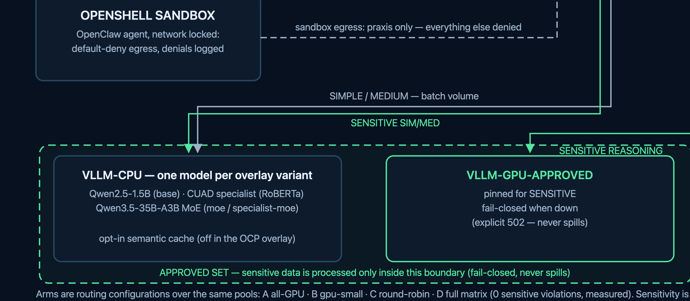

# OCTO Demo: Private, Governed Agents on Hybrid CPU + GPU Inference

Demo plan and business case · **Draft v0.2 · Status: validated** (2026-10-29 →
2026-11-02)

Every number in this document comes from our own measurements; evidence packs
and protocols live in the source repository (`FINDINGS.md` + `runs*/`). Claims
are labelled **[measured]** (our numbers, our replay), **[external]** (cited,
not ours), or **[in flight]**. v0.1's rule — no performance or cost figures
until measured — is now satisfied; the figures below are the point of v0.2.

**What changed since v0.1, in one paragraph:** the validation phase ran, on
three environments (Linux/podman, a g5.12xlarge with real GPUs, and OpenShift
SNO), against expert-annotated real contracts (CUAD), with a four-arm
measurement design. Every value hypothesis in §1 held. The architecture
settled on the Praxis gateway with the llm-d-sc semantic classifier (V13's
"unknown gateway" resolved). The demo scenario has since been extended from
single-contract review toward **contract portfolio intelligence**
(retrieval-first, evidence-first) after retrieval measurements showed method
beating backbone — that pivot and its first end-to-end number are in §2b.
What is still open is listed honestly in §6.

## Results in plain language

For readers who don't work in this stack day to day: what we set out to
prove, and what we found — without the jargon. Every statement below is
backed by the technical sections (§5–§6) and recorded evidence; this part
is the translation, not a softer set of claims.

**What we built.** A working system that reviews contracts the way a
legal-operations team would: it checks each document for personal data,
pulls out the clauses that matter (termination rights, liability caps,
governing law), flags risk, and writes a summary across the batch. Every
request passes a gateway — think of a traffic warden — that decides, per
step, whether it runs on ordinary server hardware (CPU) or a GPU, and
whether the document is sensitive enough to be locked to pre-approved
in-house systems.

**"Can this run on the servers we already own, instead of scarce GPUs?"**
Yes, and you don't lose quality. In the governed configuration, ~99% of the
work ran on CPU, and on the hardest quality test — comparing the system's
quoted clauses against expert human annotations — the CPU setup matched or
beat the GPU setup. The trade-off is speed: minutes per document on CPU
rather than seconds. For batch contract review that's acceptable — nobody
is waiting on the result in real time.

**"Is it cheaper?"**
We measured the compute actually used. The hybrid setup consumed **45×
less GPU time per document** than running everything on GPUs. At public
cloud rates, reviewing 200 contracts costs about **1 cent of GPU time
versus 57 cents** all-GPU. On hardware you already own, the saving is the
GPU capacity you didn't have to buy or queue for.

**"What happens when the GPUs are down?"**
The service keeps going. Routine work continues on CPU, unaffected.
Harder questions either wait, or get answered by the CPU model with a
visible "degraded" marker — so nobody mistakes a fallback for the full
service. And documents containing personal data are never quietly sent
somewhere unsafe: if the approved system is unavailable, the request
**fails loudly rather than spilling**. We tested this by shutting the GPU
pool off mid-run and watching the logs.

**"Can you prove private documents stayed private?"**
This is the strongest result in the demo: across every test, every
environment, every document set — **zero cases** of a sensitive document
being handled outside the approved systems. And we didn't take the
software's word for it: the proof comes from the gateway's own audit
records, like checking bank statements rather than asking the bank.

**"Is the quality actually good?"**
Three answers, plus context:
- The small cheap model is *dangerously confident*: it always answers and
  is usually wrong — quoting the wrong paragraph with no sign of doubt.
  That is the worst possible failure shape for legal work.
- The large general model is decent: it found the right clause about
  7 times in 10.
- The purpose-built approach — first *retrieve* the relevant passages,
  then have a specialist quote them exactly — was the best: **8 times in
  10, and it cannot invent quotes**, because it can only copy text that is
  actually in the contract. That is the approach the product now builds on.
- For context: the best published systems on this benchmark score roughly
  8.8 in 10, and part of anyone's gap is noise in the human annotations
  themselves.

**"Did you just get lucky with one test set?"**
We guarded against that. Every quoted number comes from a held-out test
set the models had never seen, scored against expert annotations, with
every configuration run on exactly the same documents. Where differences
are small we ran statistical tests: the headline comparisons are
significant, not luck. One honest limitation — several measurements are
single runs, labelled as such in the technical record.

**"What is the sandboxed agent for?"**
The demo's agent — the thing that would actually assist a legal-ops team —
runs inside a locked container: its network is off except for one door to
the governed gateway. Every call it makes is checked and recorded; anything
else it tries — sending data somewhere, reaching the internet — is refused
and logged. The same batch review can therefore be triggered by a plain
script or by the agent, and the gateway treats them identically. The
sandbox answers the question the gateway cannot: *what if the agent itself
misbehaves?* (Wiring the agent as the live trigger of the batch is the open
"tool-calling" item.)

**"What's still not proven?"**
- The agent using external *tools* end-to-end (bookmarked, not tested).
- The full 200-document run "at scale" and speed-under-load tests.
- The "thinking mode" quality upgrade for the judgment model.
- The Gaudi accelerators on the OpenShift cluster are dead — a driver
  problem under investigation with Intel. Irrelevant to our results, which
  used CPUs and standard GPUs.
- A few final runs were still completing when this document was written;
  the technical record (§6) lists them.

## 1. Business case

*(Unchanged from v0.1 — the problem statement survived contact with
measurement. The value hypotheses below now carry results.)*

Regulated organisations (financial services, healthcare, public sector, legal)
want agentic AI on their most sensitive documents, but: data can't leave; GPUs
are scarce and expensive; agents are risky; single pools are single points of
failure. The proposal — a self-managed inference platform running agentic
pipelines on a hybrid pool, with a label-routing gateway and a sandboxed agent
runtime — was built and measured.

**Value hypotheses — v0.1 said "to be tested, not claimed". Results:**

| # | Hypothesis (v0.1) | Result |
|---|---|---|
| 1 | A meaningful share of agent steps can run on CPU with acceptable quality | **Confirmed [measured].** ~99% of steps CPU-served in the governed arm; the CPU-served 35B-A3B MoE matched or beat the 7B-on-GPU quality (extraction 0.80 vs 0.761 mixed split; 0.712 vs 0.242 for the 1.5B on the held-out split) |
| 2 | This reduces GPU-seconds per completed task vs all-GPU | **Confirmed [measured].** 0.21 vs 9.35 GPU-s/document (45×) on the g5; a 200-document batch ≈ $0.01 of rented GPU time hybrid vs ≈ $0.57 all-GPU (calculated from measured device-time at cloud list rates) |
| 3 | Graceful degradation when the GPU pool is saturated or removed | **Confirmed [measured].** SIMPLE traffic unaffected; REASONING degrades to CPU with a visible flag; SENSITIVE+REASONING fails closed (explicit 502, never spilled) — verified from the gateway's own trace records |
| 4 (new) | Sensitive documents never leave the approved pool set | **Confirmed [measured] — the headline result.** Zero sensitive violations in the governed arm, on every stack, every dataset; the naive arms score 12–25 |

One strategic finding changed the pitch's shape: **contract review is
batch** — minutes per document on CPU tiers is operationally acceptable, so
the original "latency justifies GPU" argument is retired and is not made on
stage. GPU's remaining claims are interactive drill-down, burst absorption,
and unproven quality headroom (thinking mode).

## 2. Demo scenario

"Contract review at scale": a legal-operations team drops a batch of
contracts; the pipeline screens for personal data, extracts key clauses,
flags risks, and produces a cross-document summary. Each step is classified
and routed per step, not hand-wired per agent. **Sensitivity is a constraint;
complexity is a preference** — the two-entry routing matrix was implemented
exactly as proposed and is the demo's core governance artefact.

Quality against expert ground truth (CUAD, held-out test split, 20 documents,
same fields and scorer for every number) **[measured]**:

| configuration | extract P | extract R | extract F1 |
|---|---|---|---|
| 1.5B generative, CPU pool | 0.156 | 1.000 | 0.242 |
| 35B-A3B MoE generative, CPU pool | — | — | 0.712 |
| CUAD specialist (RoBERTa-large), full document | 0.657 | 0.958 | 0.780 |
| **specialist on top-5 retrieved chunks (litil-embed-0.6b)** | 0.667 | 1.000 | **0.800** |

The last row is the pivot's first end-to-end number: retrieve-then-extract
with a fine-tuned specialist that **cannot hallucinate by construction** (it
returns spans of the source document) beats the generative MoE by 9 F1 points
at milliseconds per clause on the CPU tier. Error decomposition: zero
retrieval misses, zero specialist misses at the top-5 window.

Risk judgment (rubric-following, vs rule-derived truth): the MoE scores 0.65
with real discrimination (16 high / 4 low); the 1.5B sits at or below the
majority-class baseline — it is not applying the rubric at all. Rubric design
matters as much as model class (a CUAD-specific rule made "always high"
optimal; the lesson is baked into the demo narrative).

### 2b. Direction: contract portfolio intelligence

The measured retrieval results justify extending the scenario from
single-contract review to portfolio queries ("which contracts contain an
audit-rights clause?"): docling ingestion on CPU with PII screening at ingest,
tiered legal embeddings, specialist span extraction, MoE synthesis over
retrieved evidence — every hop through the governed gateway. First
measurements: the MTEB(Law) leaderboard ordering **inverts** on our
within-document task (the 0.6B embedder significantly beats the top-scoring
8B, McNemar p = 0.0001) while the 8B wins the cross-document regime —
embedding tiers follow *measured regime fit*, not the leaderboard. The
external method ladder points the same way: on a fixed CUAD backbone,
Standard 72.9 → RAG 79.3 → multi-agent 85.8 F1 **[external]** — method moves
CUAD numbers more than backbone size, and our 0.800-vs-0.712 result is that
prediction confirmed on our stack.

### On-stage moments

1. Fan-out / escalation / kill switch: choreographed and working on all
   three stacks (live arm swaps through the gateway's config watcher).
2. Pull the plug: GPU pool to zero mid-run; degradation and recovery visible
   in the trace waterfall. **[measured]**
3. Sensitivity pinning: zero violations, verified from the gateway's own
   SQLite audit trail, not the pipeline's say-so. **[measured]**
4. The agent is blocked: sandbox egress denial with policy YAML and live
   denial logs — working on the Linux stack; re-verification on OpenShift is
   on the open list. **[in flight]**

### 2c. Two doors for the same batch — the secure-agent story

The same batch review can be triggered two ways, and the difference *is*
the security story:

|  | Vanilla client | Sandboxed agent (OpenShell) |
|---|---|---|
| What it is | A scripted pipeline — cron job, CI run, notebook: any caller | An autonomous agent (OpenClaw) in a hardened runtime |
| What could go wrong | Misrouting: a sensitive document served by the wrong pool | Misrouting *and* the agent itself: exfiltration or unauthorized actions (including via prompt injection) |
| Where governance lives | With the request — the gateway's label matrix, pinning, fail-closed, audit | With the request **and** the caller — default-deny network, gateway-only egress, every denial logged |
| What it proves | The gateway governs whatever calls it (0 violations, measured) | A contained agent: even a fully compromised agent has a blast radius of zero |

The through-line: the two runs are **indistinguishable at the pool level** —
same labels, same routing decisions, same audit records, because both go
through the same gateway. The gateway never had to trust the caller; the
sandbox means nobody has to. On stage: run the batch vanilla, then move the
same batch into the sandbox, let the agent run it identically, then have it
attempt one unauthorized action — denied, logged, blast radius zero.

Honest edges, stated: the vanilla client is unconstrained *before* the
gateway (a leaky client can still misbehave locally), and the sandbox does
not improve models or routing — it contains the agent. Measurement
discipline: the four arms are measured through the scripted client so every
replay is identical; agent-driven review is the open V2 tool-calling item.

## 3. Architecture (as built)

*(Source: `docs/architecture-as-built.svg`.)*

- **Praxis** is the gateway (V13 resolved); **llm-d-sc** supplies
  complexity labels (the pipeline's PII screen is what picks the
  sensitive entry — two labels in one routing chain remains open, V19);
  four routing configurations implement the
  measurement arms; the same configs drive Linux and OpenShift byte-identically.
- Pools are plain vLLM Deployments on OpenShift (KServe storage-initializer
  cannot reach HuggingFace on this cluster — documented, worked around).
- The **CUAD specialist** is a composite pool: extraction prompts answered by
  the fine-tuned RoBERTa-large QA checkpoint in one encoder pass; everything
  else forwarded to the general model behind the same relay. An opt-in
  semantic cache with the agreed ordering rules is available (measured on
  the Linux stack — zero-FP threshold 0.98; off in the OCP overlay as
  deployed: exact-match always safe, similarity serving never stores or
  serves sensitive content).

**Models actually used** (replacing v0.1's candidates, which were never
touched): CPU tier — Qwen2.5-1.5B and Qwen3.5-35B-A3B MoE (vLLM, Xeon,
16k context); GPU tier — Qwen2.5-7B (g5); specialist — RoBERTa-large CUAD
checkpoint (Zenodo); embeddings — litil-embed-0.6b / octen-law-8b-v1
(measurement-selected). Licences verified (V12): Apache-2.0 models, CC BY 4.0
dataset, no customer data anywhere.

## 4. Phased plan — status

| Phase | Exit criteria (v0.1) | Status |
|---|---|---|
| 1: agent + gateway + multi-replica vLLM | pipeline end-to-end on both pools; baseline captured | **Done** — plus full-platform validation on OpenShift (4.22 SNO) |
| 2: EPP + semantic layer + dashboard | measured improvement vs round-robin and all-GPU; quality within tolerance; survives GPU removal | **Done** — four arms measured; 45× GPU-s reduction at equal-or-better quality; degradation verified; live dashboard + audit export |
| 3: OpenShell | sandboxed pipeline; denied action demonstrated | **Done** on Linux; OpenShift sandbox deployed, blocked-action moment pending re-verification |

## 5. Measurement design (as run)

Same documents, same replay, same scorer for every arm; CUAD held-out test
split for all quoted numbers (a mixed split containing train documents read
optimistically and is no longer quoted); contamination discipline for the
fine-tuned specialist (test.json only); governance verified from the
gateway's own records, independently of the pipeline.

| Arm | Description | Result **[measured]** |
|---|---|---|
| A | All-GPU, large model | 25/25 sensitive violations; 9.35 GPU-s/doc; F1 0.712-class quality |
| B | All-GPU, small model for simple steps | 25/25 violations — the skeptic's alternative measured and beaten (V18) |
| C | Hybrid, round-robin | 12–24 violations — unclassified hybrid is not governance |
| **D** | **Classifier + two-entry matrix + fail-closed** | **0 violations, every stack, every dataset; ~99% CPU-served; 0.21 GPU-s/doc** |

Cost discipline held: device-time measured exactly (simulated counters +
live /metrics integration), priced only as a sweep (cloud list vs owned at
25/50/75% utilisation). No single $/document figure is claimed beyond the
labelled $0.01-vs-$0.57 calculation. A validated organisational cost model
remains open (V17).

## 6. Validate first — results

Ordered as in v0.1. This table is the audit trail — the plain-language
summary of what these checks mean is in "Results in plain language" above.
"Open" items are the honest remainder.

| # | Item (v0.1) | Result |
|---|---|---|
| V1 | Agent prompt size vs CPU prefill/TTFT | Partially retired: workload is batch; long-context prefill measured as the ~50% CUAD slowdown vs synthetic; context capped at 16k. TTFT/concurrency sweep (hybrid-bench) **open** |
| V2 | Tool calling through the full stack | **Open** |
| V3 | CPU model loads and runs on our hardware | **Validated** — 1.5B/7B/9B/35B-A3B served by vLLM on Xeon; plain builds, no vendor tuning needed |
| V4 | Routing by model name; prefix caching on CPU | **Validated** via Praxis label routing (architecture evolved past plain EPP); prefix-cache engagement not separately isolated |
| V5 | Semantic cache hit/FP rates; threshold | **Validated** — threshold sweep: zero-FP operating point 0.98 with 41.7% hits; similarity layer awaits a real embedder (litil is the measured swap-in) |
| V6 | Fan-out limits; 200-document visual | Concurrency 12 stable; the 200-document scale run **open** |
| V7 | Failover: kill the GPU pool mid-run | **Validated** — degradation, fail-closed, isolation, recovery, all stacks |
| V8 | Quality harness + acceptance threshold | **Validated** — evalkit scorer vs CUAD ground truth; every arm compared to Arm A on identical fields |
| V9 | OpenShell on OpenShift | **Validated** — Helm install, SCC and CRDs handled; runbook scripted |
| V10 | Sandbox → gateway path | **Validated** — in-cluster plain-HTTP policy proxy; egress praxis-only, default-deny, logged |
| V11 | Observability plumbing | **Validated** — trace waterfall, arms panel, dashboard, metrics sampler, JSONL audit export |
| V12 | Licences | **Validated** — Apache-2.0 models; CUAD CC BY 4.0 (confirmed on the Atticus site); no customer data |
| V13 | Define the "Praxis gateway" | **Resolved** — Praxis is the gateway; llm-d-sc the classifier; four config-driven arms |
| V14 | Classifier transfer to contract steps | **Validated with a twist** — llm-d-sc labels all contract-analysis steps MEDIUM, only cross-doc reports REASONING; within-tier composition lives in the composite pool; prompt wording calibrated so report prompts label REASONING; disagreement reported, never hidden |
| V15 | Sensitivity enforcement beyond the classifier | **Validated** — PII screen (P 1.0 / R 1.0 synthetic; 5–12/20 CUAD docs flagged), NetworkPolicies, and gateway-record verification; two-label routing in a single chain remains **open** (V19) |
| V16 | GPU-removal for in-flight REASONING | **Validated** — bounded degradation with visible badge; fail-closed for sensitive; recovery verified |
| V17 | Cost model agreement | **Partial** — device-time exact; priced as sweep only; org-validated rates open |
| V18 | Skeptic's baseline (Arm B) | **Validated** — measured and beaten; the CPU MoE additionally beat the 7B-on-GPU on quality (0.80 vs 0.761 mixed split) |
| V19 | Both labels routed at once | **Open** — implemented as two gateway entries (general/sensitive); single-chain two-label routing unvalidated |

**Also open:** thinking-mode A/B (Qwen3.5 thinking is the untested quality
lever for the judgment tier); the 7B on the held-out test split (headline
hygiene); ContractNLI as the risk-tier evaluation; docling ingestion module;
the embedding-tier regime decision (cross-document corrections and the
dinghy-8B evaluation are **[in flight]** as of this draft); the
specialist/specialist-moe arms through the full stack on OpenShift **[in
flight]**.

## 7. Documents and data — as used

CUAD v1 (CC BY 4.0, confirmed): 510 expert-annotated commercial contracts;
held-out **test split** for every quoted number; 41 clause categories with
4 mapped to the demo scenario. The golden-set practice from v0.1 became the
20-document held-out set with recorded evidence per run. Annotation noise is
measured and stated (precision is a lower bound for all models; comparisons
remain fair on identical annotations). CUAD has no data-protection category —
the DP clause is exercised with synthetic PII documents instead, which also
drives the sensitivity screen.

## 8. Risks — revisited

| Risk (v0.1) | Outcome |
|---|---|
| CPU latency compounds across sequential steps | Retired by measurement: the workload is batch; "same quality, different speed" is the degradation story, not the steady-state pitch |
| OpenShell alpha / experimental Kubernetes path | Worked on OpenShift 4.22 with documented SCC/Helm overrides; still presented as demo-cluster, not production |
| Privileged SCC concerns | Handled upfront; sandbox SCC scoped and documented |
| Semantic cache returns wrong answers | Zero-FP threshold measured (0.98); FP rate shown honestly per arm |
| Vendor-tuned builds may not run | Moot — plain vLLM builds served every model on Xeon |
| Demo depends on unmeasured numbers | No longer: every on-stage number traces to a recorded run |

New risks worth naming: **annotation noise is the quality ceiling** (CUAD's
SOTA ≈ 88.3 F1 **[external]**; our 0.800 sits against that bound); the
cluster environment is shared (our OpenShift namespace was found emptied once
— all evidence is local and the stack is redeployable from runbooks);
single-run measurements are labelled as such and significance is computed
where per-pair data exists.

## 9. References

- Source repository: demo code, runbooks, evidence packs (`runs*/`),
  and the full measurement record (`FINDINGS.md`) — the primary reference.
- CUAD: the Atticus Project (CC BY 4.0).
- Praxis gateway; llm-d-sc semantic classifier; vLLM; OpenShell / OpenClaw.
- External CUAD method ladder and SOTA: see FINDINGS §3.5 (aggregators —
  verify against primary papers before external publication).
